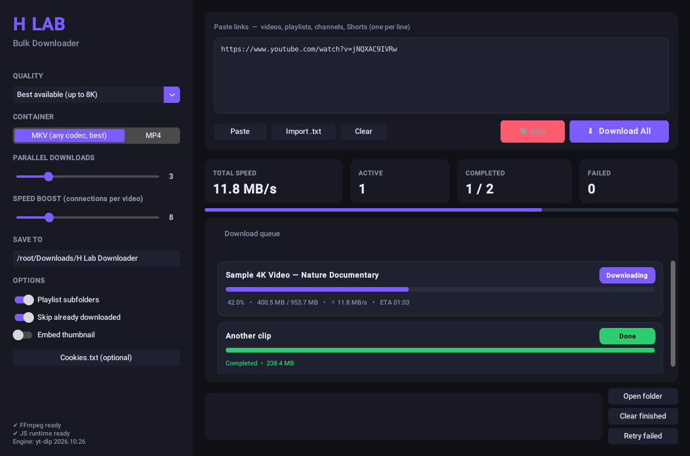

# H Lab Downloader

Bulk YouTube downloader for Windows with a modern dark interface.



## Features

- **Bulk downloads, no limits.** Paste as many links as you want. Videos, Shorts, playlists and whole channels all work, and playlists and channels are expanded into single videos automatically.
- **Highest quality.** "Best available" picks the top resolution YouTube has (up to 8K / HDR / 60fps) and merges it with the best audio. You can also cap it at 4K, 1440p, 1080p, 720p or 480p, or get audio only (MP3 320k or original M4A).
- **Fast.** Several videos download at once (1 to 10), and each video can use up to 32 connections at the same time.
- **Live speed indicator.** Each item shows its own progress bar, %, size, speed and ETA. The top of the window shows total speed, active, completed and failed counts.
- **Reliable.** Unfinished downloads resume, failed ones can be retried with one click, and "Skip already downloaded" keeps a history file so the same video is never downloaded twice.
- **Tidy files.** Each playlist or channel can go in its own subfolder, with Windows-safe file names. You can also embed the thumbnail.
- **Cookies support.** Load a `cookies.txt` for age-restricted or members-only videos.

## Download (ready-made EXE)

Go to **Releases** and download `HLabDownloader-Windows.zip`. Unzip it and run `HLabDownloader.exe`.
FFmpeg and Deno already come inside the zip, so there's nothing else to install.

## Run from source

Install Python 3.10+ from python.org, then double-click **`run.bat`**.

Or run these commands:

```bat
pip install -r requirements.txt
python h_lab_downloader.py
```

For full 4K/8K support, install Deno and FFmpeg:

```bat
winget install DenoLand.Deno
winget install Gyan.FFmpeg
```

(The app also uses its own built-in FFmpeg if none is installed.)

## Build the EXE yourself

1. Put `ffmpeg.exe` and `deno.exe` in this folder. This step is optional, but recommended.
2. Double-click **`build.bat`**.
3. The app appears at `dist\HLabDownloader\HLabDownloader.exe`.

On GitHub, the workflow in `.github/workflows/build.yml` builds the zip automatically:

- **Push a tag** like `v1.0.0` to publish a Release.
- **Run it manually** from the Actions tab.
- **Weekly rebuild:** it also rebuilds once a week, so the download engine (yt-dlp) stays up to date when YouTube changes things.

## Tips

| Goal | Setting |
|---|---|
| Max quality, any codec (AV1/VP9, HDR) | Quality: Best, Container: **MKV** |
| Plays everywhere (phones, editors, TVs) | Container: **MP4** (prefers H.264) |
| Faster big batches | Parallel 3–5, Speed boost 8–16 |
| Music / podcasts | Audio only – MP3 320k |

If downloads start failing after a YouTube change, update the engine: run `pip install -U yt-dlp`, or download the newest release.

## Legal

Only download content you own or have permission to download. Follow YouTube's Terms of Service and copyright law.
